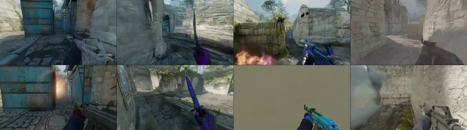
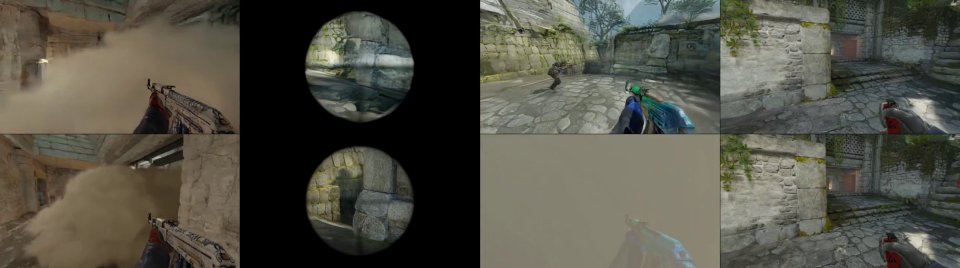
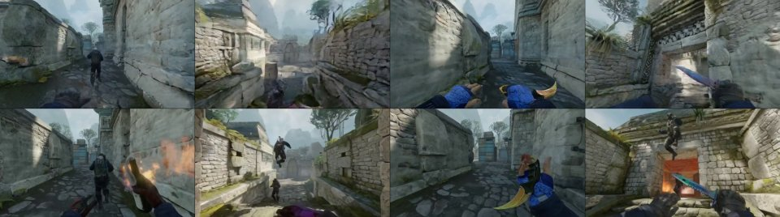
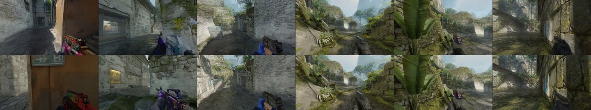
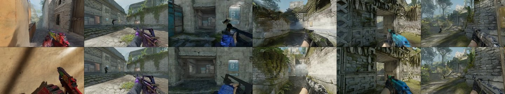
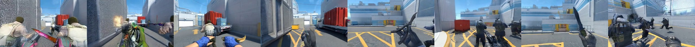
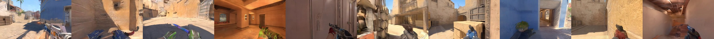
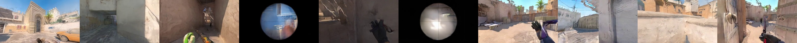

# Example inputs

The examples are grouped by player count. Every player stream has 165 RGB frames (42 latent frames).

- `4players/` contains `4_01`–`4_05`, with both raw and precomputed inputs.
- `6players/` contains `6_01`–`6_03`, from source cases 10, 26, 40, respectively.
- `8players/` contains `8_01`–`8_02`, from source cases 87, 84, respectively.
- `10players/` contains `10_01`–`10_02`, from more-scene source cases 8, 21, respectively.

The 6-, 8-, and 10-player sets contain raw inputs. All four sets use the 4-player checkpoint, with run settings `4players`, `4infer6`, `4infer8`, and `4infer10`.

Each directory is named `<players>_<number>`. The CSV `case_id` and CLI `--case` use the integer number: `--num_players 6 --case 1` selects `6_01` and writes `outputs/inference/4infer6/video1_grid.mp4`. Case IDs remain stable if the CSV is reordered. Each manifest preserves the original `source_row_index`; use the sequential case ID, not the source row, on the CLI.

## Layout

```text
asset/examples/
├── 4players/                  # examples 4_01 through 4_05
│   ├── inputs.csv             # raw inputs
│   ├── metadata.csv           # precomputed inputs for inference/training
│   ├── manifest.json
│   └── 4_01/
│       ├── player=XX/         # first_frame.png, ticks.parquet, video_K.*.pt
│       ├── groups.pt
│       ├── grouping_state.npz
│       └── preview.jpg
├── 6players/                  # examples 6_01 through 6_03
├── 8players/                  # examples 8_01 and 8_02
└── 10players/                 # examples 10_01 and 10_02; more-scene inputs
    ├── inputs.csv
    ├── manifest.json
    └── 10_01/
        ├── player=XX/         # first_frame.png, ticks.parquet
        └── preview.jpg
```

The 6- and 8-player directories follow the same layout as the 10-player directory. CSV paths are relative to their player-count directory.

## Raw inputs

[inference_demo.yaml](../../configs/inference_demo.yaml) reads `inputs.csv` from `4players/`; `--num_players 6`, `8`, or `10` selects the corresponding directory. Each row has a `case_id`, which sets the output number, and three columns per player `i`:

| Column | Content |
| --- | --- |
| `image_path{i}` | First frame of the clip. Frames that are not 640×352 are scaled to cover that size and center-cropped. |
| `ticks_path{i}` | Tick log with one row per 64 Hz tick, as described below. |
| `caption{i}` | Text prompt; may be empty. |

Frames run at 32 fps, so every two tick rows form one frame. The clip is the last 165 frames of the tick log. The rows before it provide history for player grouping, which reads up to 48 frames before the clip. Clips at the start of a round have only the history available at that point. The tick logs of a row must have the same length and come from the same round. The log needs these columns:

| Columns | Used for |
| --- | --- |
| `active_ids`, `delta_yaw`, `delta_pitch`, `input_weapon` | keyboard and mouse actions |
| `tick`, `x`, `y`, `z`, `yaw`, `pitch`, `active` | camera poses at the latent frames; `active` contains `duck` while crouching |
| `tick`, `x`, `y`, `z`, `yaw`, `pitch`, `is_alive` | player groups, using the clip and the 48 frames before it |

For a longer log, such as a whole round, add a `start_frame` column with the first clip frame; frame `f` is tick rows `2f` and `2f+1`. Optional `source{i}` columns of the form `match_id=M/map_name=X/round=R/player=S` record where each stream came from.

At inference, prepared actions and cameras are written to `outputs/prepared_inputs/<setting>/run-*/`, with a distinct directory for every run. Generated group labels use the content-addressed `outputs/grouping_cache/`. The first frames are encoded with the Wan2.2 VAE. The text prompts are encoded directly from the captions, as for the precomputed inputs. Because raw inputs contain no reference video, the output grid shows only the generated views.

The reference previews below come from H200 runs with precomputed first-frame latents. Fresh VAE encoding on H20 can lead to visible differences in motion and viewpoint later in the clip, even with the same seed. This affects the 6-, 8-, and 10-player examples as well as the 4-player examples. The precomputed-input option below keeps the original first-frame latents for the 4-player set.

In the current H20 checks, the two 10-player examples also retain visible differences from H200 when the original first-frame latents are reused. Their inference commands run successfully, but close cross-GPU reproduction remains unresolved.

## Precomputed inputs

The 4-player set includes precomputed inputs. `4players/metadata.csv` points to the files the raw inputs produce, together with the latents of the full reference clips. Training and the training demo read it. To run inference from it and add the VAE reconstruction of each reference clip below the generated views, pass `--metadata_file_name metadata.csv`.

The video path columns only identify the source of each stream; the source MP4 files are not needed.

Each case includes `grouping_state.npz`, which stores the player positions, view angles, and alive/present flags used to compute the group labels, including the preceding 48 frames of history. With this file, training and inference can regenerate a missing `groups.pt` without the tick logs. The 42 camera matrices in the camera files are not enough for this, because they cover only the clip itself and contain no alive flags.

## Check the inputs

From the repository root, check every file of all four sets against the checksums in their `manifest.json`:

```bash
python scripts/demo_assets.py --verify
```

Prepare the 4-player raw inputs and compare them with the precomputed ones. The actions, camera poses, captions, grouping states, and all 24 group-label fields must be identical. Only the fields that record the clip's position in its source round are excluded, because the precomputed files were cut from whole rounds:

```bash
python scripts/check_raw_inputs.py
```

On a GPU, add `--vae models/Wan-AI/Wan2.2-TI2V-5B/Wan2.2_VAE.pth` to also compare the encoded first frames with the first latent frame in `metadata.csv`. This reports the differences rather than requiring bitwise equality across GPUs. The generation implications are described in the reproducibility notes above.

To recompute only the group labels and compare them with the included ones:

```bash
python scripts/prepare_groups.py --dataset_path asset/examples/4players --verify_existing
```

See [dynamic grouping](../../docs/DYNAMIC_GROUPING.md) for the grouping state format.

## Reference previews

### Four players

Each preview shows frame 82, with generated player views above the VAE reconstruction of the inputs. They were produced from the precomputed inputs with the [example inference configuration](../../configs/inference_demo.yaml): 50 denoising steps, guidance scale 5, and attention window 21.

| Example | Preview |
| --- | --- |
| `4_01` |  |
| `4_02` |  |
| `4_03` |  |
| `4_04` |  |
| `4_05` |  |

### Four-player model with six players

These H200 reference previews show frame 82, with generated views above VAE reconstructions of the source clips. Raw-input inference produces only the generated row.

| Case | Preview |
| --- | --- |
| `6_01` |  |
| `6_02` |  |
| `6_03` |  |

### Four-player model with eight players

These previews show generated H200 views at frame 82.

| Case | Preview |
| --- | --- |
| `8_01` |  |
| `8_02` |  |

### Four-player model with ten players

These more-scene previews show generated H200 views at frame 82.

| Case | Preview |
| --- | --- |
| `10_01` |  |
| `10_02` |  |
